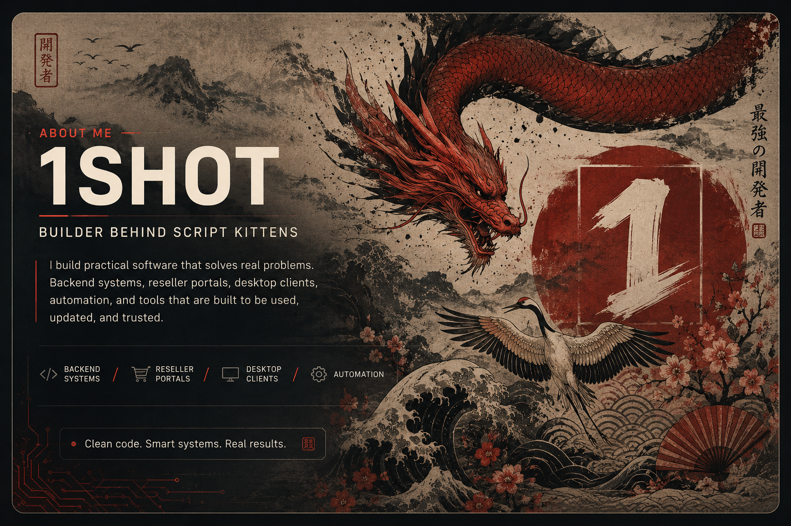
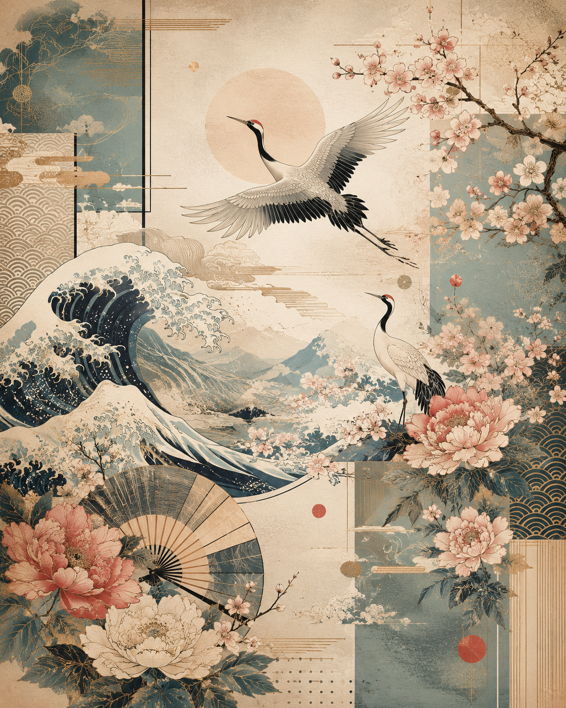

<div align="center">

  

  <br/>
  <br/>

  <a href="https://script-kittens.com">
    
  </a>
  &nbsp;
  <a href="https://auth.script-kittens.com">
    
  </a>
  &nbsp;
  <a href="https://discord.gg/AqkdsPMU7M">
    
  </a>
  &nbsp;
  <a href="https://www.youtube.com/@1shot1moanz">
    
  </a>

</div>

---

### ⛩️ About Me

<table>
<tr>
<td width="40%" align="center">
  
</td>
<td width="60%">

Hey, I'm **1shot**, the builder behind **Script Kittens**.

I build practical software that solves real problems: backend systems, reseller portals, desktop clients, automation, and tools that are built to be used, updated, and trusted.

```text
make it usable
make it controllable
make it reliable enough to sell
```

The focus is simple: build tools that can be shipped, managed, updated, and trusted — without turning every small change into a full rebuild.

- 🌐 **Main Platform:** [script-kittens.com](https://script-kittens.com)
- 🔐 **Licensing & Auth:** [auth.script-kittens.com](https://auth.script-kittens.com)
- 🛠️ **Core Specialties:** C++, Win32 / DirectX 11, ImGui, Python, Backend Automation

</td>
</tr>
</table>

---

### 🐱 CatCrypt — Licensing & Auth Backend

My licensing and authentication platform for software products. HWID machine binding, license keys, a live operator dashboard, and SDKs — from **$0**.

- 🔐 HWID binding — every account locks to a trusted machine
- 🎫 License keys — generate, redeem, and track (Free $0 / Starter $1 / Pro $2)
- 🟢 Live sessions & instant revocation
- 📁 Runtime Vault — protected file delivery to entitled users only
- 🤖 **Cat Agent** — AI operator that runs your dashboard for you

**SDKs — full feature parity (login, register, redeem, validate, variables, files, `is_paid`):**

| Language | SDK |
| --- | --- |
| Python | [`CatCrypt-Python-Example`](https://github.com/ScriptKittenss/CatCrypt-Python-Example) |
| C# | [`CatCrypt-CSharp-Example`](https://github.com/ScriptKittenss/CatCrypt-CSharp-Example) |
| C++ | [`CatCrypt-CPP-Example`](https://github.com/ScriptKittenss/CatCrypt-CPP-Example) |

🔗 **Repo:** [ScriptKittenss/CatCrypt](https://github.com/ScriptKittenss/CatCrypt) · **Portal:** [auth.script-kittens.com](https://auth.script-kittens.com)

---

### 🛒 The Kitty Line

| Product | Price | What it is |
| --- | --- | --- |
| **Kitty Internal Panel** | $15 | C++ overlay — aimbot, ESP, exploits, HWID locked |
| **Kitty External Panel** | $10 | Python engine — multi-bone aimbot, chams & ESP |
| **Kitty UID Bypass** | $7 | Bypasses PC detection via UID, instant delivery |
| **Free Fire API** | $5 | Player info, stats, ban check, 15+ endpoints |
| **Level Up Panel** | $70 | Automated guest-account leveling to Lv. 20 |

🛒 **Buy:** Discord tickets — join the [Discord](https://discord.gg/AqkdsPMU7M) and open a ticket. Payments: crypto, Easypaisa, JazzCash, bKash, UPI.

---

### 🎬 Script Kittens on YouTube

Game-hacking tutorials — aimbots, ESP, offsets, libil2cpp, reverse engineering. New lectures in the **YouTube Series Internal Panel** playlist.

🔗 **Channel:** [@1shot1moanz](https://www.youtube.com/@1shot1moanz)

---

### 🛠️ Tech Stack

<div align="center">


<br/>
<br/>


</div>

---

### 📊 GitHub Stats

<div align="center">


</div>

---

### 📬 Connect

<div align="center">

<a href="https://script-kittens.com">
  
</a>
<a href="https://auth.script-kittens.com">
  
</a>
<a href="https://discord.gg/AqkdsPMU7M">
  
</a>
<a href="https://www.youtube.com/@1shot1moanz">
  
</a>
<a href="mailto:alfurqanimran@gmail.com">
  
</a>

<br/>
<br/>

> *"Clean code. Smart systems. Real results."*

<sub>Script Kittens © 2026 — Systems / Portals / Automation</sub>

</div>
