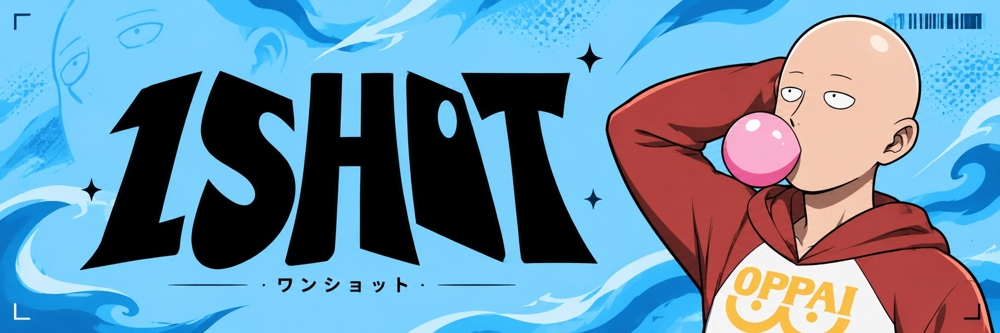
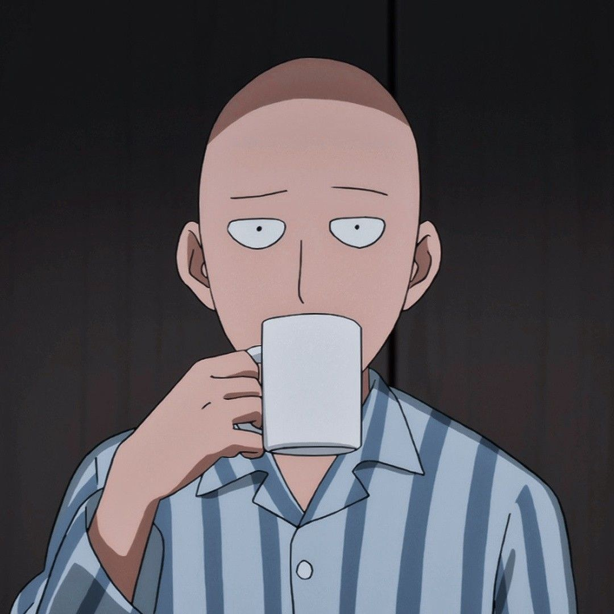
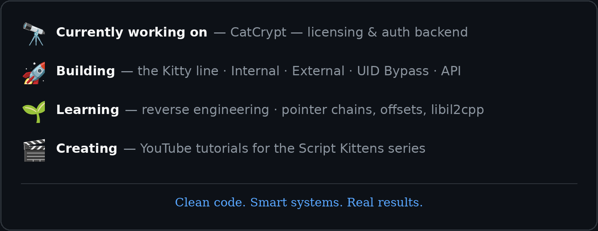
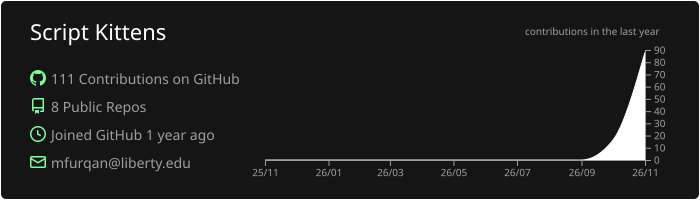
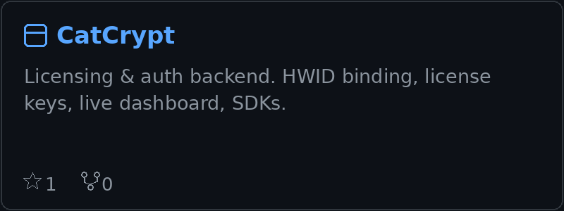
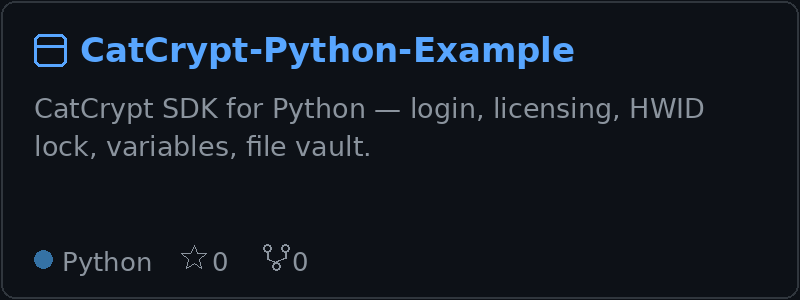
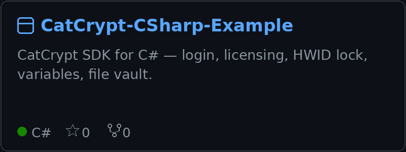
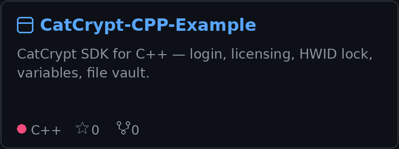
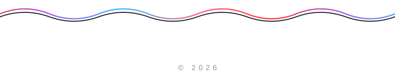

  

   

  
  
  

   

  

---

### Who Am I?

Hey, I'm **1shot~1moan** — Co-Founder of **Script Kittens** and **Varino.Net**, and Lead Developer across both.

I build practical software that solves real problems: backend systems, licensing & authentication platforms, reseller portals, desktop clients, and automation — tools that are built to be used, updated, and trusted.

My current focus is **CatCrypt**, my licensing & auth backend, and the **Kitty** product line. I also create game-hacking tutorials on YouTube — aimbots, ESP, offsets, libil2cpp, and reverse engineering.

 

---

### A Little More About Me

---

### 📊 GitHub Status

 

---

### 🛠️ My Stacks

---

### 📌 My Best Repositories

 

 

---

    

---

