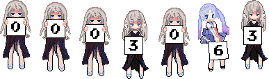
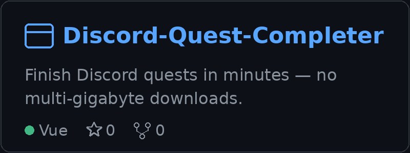
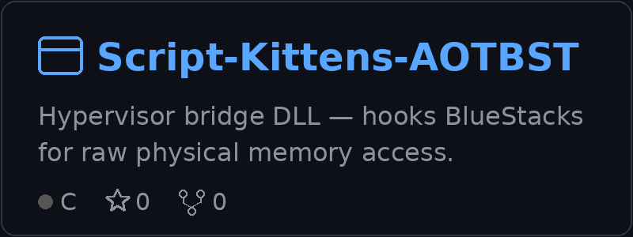
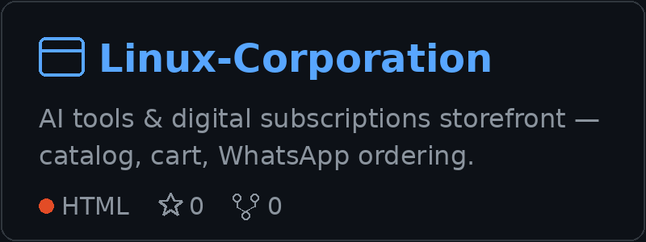

  

   

  
  
  

   

  

---

### Who Am I?

Hey, I'm **1shot~1moan** — Co-Founder of **Script Kittens** and **Varino.Net**, and Lead Developer across both.

I build software people actually use: licensing & auth platforms, reseller portals, desktop clients, backend systems, and automation — tools that are built to be used, updated, and trusted.

Right now I'm deep into **AI model APIs** — pooling free AI accounts (Antigravity, Qwen, Gemini) into one API with CLIProxyAPI — alongside **CatCrypt**, my licensing & auth backend, and the **Kitty** product line. I also make game-hacking tutorials on YouTube — aimbots, ESP, offsets, libil2cpp, and reverse engineering.

 

---

### A Little More About Me

---

### 📊 GitHub Status

 

 

---

### 🛠️ My Stacks

---

### 📌 My Best Repositories

 

 

---

&nbsp;&nbsp;&nbsp;&nbsp;&nbsp;&nbsp;&nbsp;&nbsp;&nbsp;&nbsp;&nbsp;&nbsp;&nbsp;&nbsp;&nbsp;

<a href="https://script-kittens.com"><b>Main Website</b></a> · <a href="https://auth.script-kittens.com"><b>Auth Website</b></a>

---

